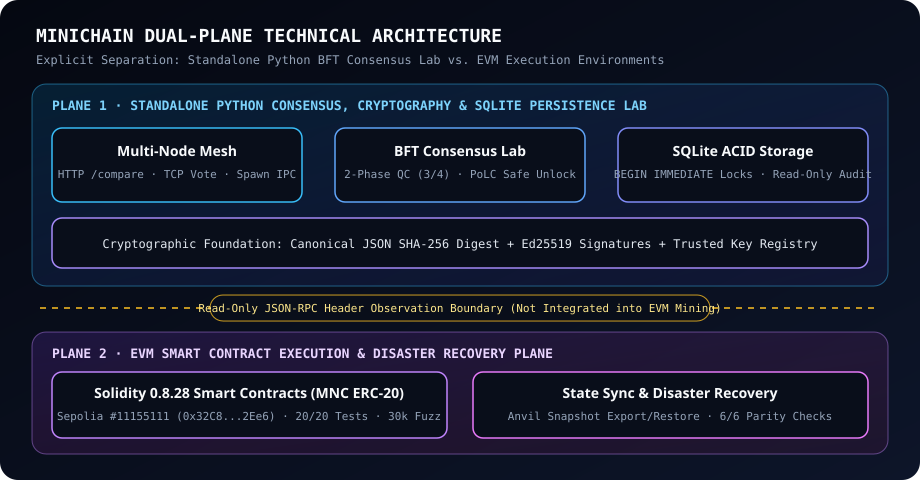

<p align="center">
  
</p>

<h1 align="center">MiniChain</h1>

<p align="center">
  <strong>Open-Source Distributed Consensus, Crash-Safe Persistence &amp; EVM Smart Contract Engineering Lab</strong>
</p>

[](./LICENSE)
[](./contracts)
[](./docs/TEST_REPORT.md)
[](./contracts/test/MNCFuzz.t.sol)
[](https://sepolia.etherscan.io/token/0x32C80Bb0fd51D32c31b52795a181042BF90E2Ee6)

**[Official Website](https://oepjdihc2008.github.io/minichain/)** · **[MiniScan Sepolia Explorer](https://oepjdihc2008.github.io/minichain/explorer/)** · English | [简体中文](./README.zh-CN.md)

MiniChain is an independent, from-first-principles blockchain systems engineering project built to study cryptographic ledgers, Byzantine Fault Tolerant (BFT) quorum safety, crash-safe validator locking, state recovery, and fuzz-verified EVM smart contracts—without black-box bloat or financial hype.



---

## Architectural Transparency Notice

MiniChain is intentionally structured into **two explicitly separated engineering planes**:

1. **Standalone Python Consensus & Persistence Lab (`core-pow/`, `consensus-lab/`)**: Implements SHA-256 Proof-of-Work, Ed25519 signature registries, `3f + 1` BFT quorum intersection proofs, Two-Phase (`PREVOTE` -> `PRECOMMIT`) Quorum Certificates, SQLite `BEGIN IMMEDIATE` lock-before-sign persistence, exhaustive 81-state split-lock deadlock analysis, and Tendermint-style Proof-of-Lock-Change (PoLC) safe unlocking. When run alongside local Foundry Anvil nodes, Python validators observe chain headers externally via read-only JSON-RPC—they are **not** integrated into Anvil's internal block-production loop.
2. **EVM Smart Contract & State Recovery Plane (`contracts/`)**: Zero-dependency `Solidity ^0.8.28` contracts (`MiniChain`, `MiniChainV2`, and `MiniChain Coin / MNC`), verified by 20/20 Foundry tests, 30,000 randomized fuzz runs, 6/6 disaster recovery checks, and deployed on **Ethereum Sepolia Testnet**.

> **Non-Financial & Audit Disclaimer:** `MNC` is an experimental Ethereum Sepolia testnet token with **zero monetary value**. There is no mainnet token, token sale, or liquidity pool. MiniChain has **not** undergone an independent third-party commercial security audit.

---

## Public On-Chain Artifact (Ethereum Sepolia)

| Parameter | Verified Value |
| :--- | :--- |
| **Network** | Ethereum Sepolia (`Chain ID: 11155111`) |
| **Token Name & Symbol** | MiniChain Coin (`MNC`) |
| **Fixed Total Supply** | `1,000,000 MNC` (`18` decimals) |
| **Contract Address** | [`0x32C80Bb0fd51D32c31b52795a181042BF90E2Ee6`](https://sepolia.etherscan.io/token/0x32C80Bb0fd51D32c31b52795a181042BF90E2Ee6) |
| **Deployment Block** | `#12207520` |
| **Genesis Deployment Tx** | `0x40c220f1c9f4bdcd770965b8b3d1c9e6d253cb5067b27859d2456413d4b7b4b8` |

---

## Verified Engineering Metrics

- **20 / 20 Smart Contract Tests Passing** (`contracts/test/*.t.sol`)
- **12 / 12 Dedicated MNC ERC-20 Tests Passing** (`MNCTest` + `MNCFuzzTest`)
- **30,000 / 30,000 Randomized Fuzz Runs Passing** (`supply conservation`, `self-transfer invariance`, `allowance accounting`)
- **6 / 6 Disaster Recovery Checks Passing** (`consensus-lab/recovery_check.py`: Chain ID, height, block hash, `stateRoot`, bytecode, balance conservation)
- **60 / 60 Standalone Python BFT, Locking, Unlock & Finality Checks Passing**

---

## Quickstart

### 1. Verify Smart Contracts & 30,000 Fuzz Runs
```bash
cd contracts
forge test -vv
forge test --match-contract MNCFuzzTest --fuzz-runs 10000
```

### 2. Run Python PoW, BFT Consensus & 6/6 Disaster Recovery Labs
```bash
pip install cryptography
python3 core-pow/blockchain.py

cd consensus-lab
python3 bft_test.py
python3 fault_test.py
python3 cross_round_test.py
python3 locking_test.py
python3 leader_test.py
python3 unlock_test.py
python3 finality_test.py
python3 recovery_check.py
```

### 3. Build & Preview Official Website + Read-Only MiniScan Explorer
```bash
cd website
npm install
npm run build
npx serve out -l 3000
```

---

## Documentation Index

- [Whitepaper](./docs/WHITEPAPER.md)
- [Technical Architecture](./docs/TECHNICAL_ARCHITECTURE.md)
- [API & Protocol Reference](./docs/API_DOCUMENTATION.md)
- [Developer Guide](./docs/DEVELOPER_GUIDE.md)
- [Security Report & Known Limitations](./docs/SECURITY_REPORT.md)
- [Verified Test Report](./docs/TEST_REPORT.md)
- [Engineering Roadmap](./docs/ROADMAP.md)
- [Zero-Cost (RM0) Static Deployment Guide](./docs/FREE_DEPLOYMENT_GUIDE.md)

---

## Contributing & Community

Contributions, distributed-systems critiques, formal verification specs, and bug reports are warmly welcomed! Please read [CONTRIBUTING.md](./CONTRIBUTING.md) and [SECURITY.md](./SECURITY.md) before opening a pull request.

## License

Released under the [MIT License](./LICENSE).
