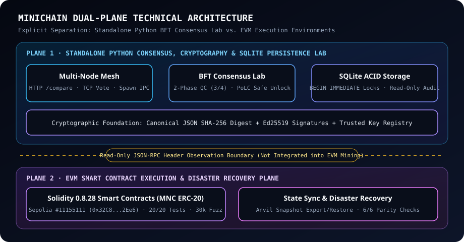

# MiniChain（简体中文说明）

**开源分布式 BFT 共识实验、崩溃安全持久化与 EVM 智能合约工程研究项目**

**[访问官方网站](https://oepjdihc2008.github.io/minichain/)** · **[MiniScan 链上浏览器](https://oepjdihc2008.github.io/minichain/explorer/)** · [English](./README.md) | 简体中文

MiniChain 是一个从第一性原理出发构建的开源区块链工程实验室，专注于密码学账本、拜占庭容错（BFT）法定人数交集证明、SQLite 跨轮次原子锁存储、状态快照灾难恢复，以及经 Foundry 随机模糊测试验证的 Solidity 智能合约研究。



---

## 架构诚实性声明

MiniChain 严格区分以下两个独立工程平面，绝不夸大底层集成状态：

1. **独立 Python 共识与存储实验室 (`core-pow/`, `consensus-lab/`)**：实现 SHA-256 工作量证明、Ed25519 数字签名与公钥指纹注册表、`3f + 1` 法定人数交集验证、两阶段投票（`PREVOTE` -> `PRECOMMIT`）证书、SQLite `BEGIN IMMEDIATE` 先落盘锁定后签名、81 种跨轮次锁状态死锁穷举分析，以及 Tendermint 风格高轮次 QC 安全解锁。在与本地 Anvil 节点联调时，Python 进程仅通过只读 JSON-RPC 外部观测区块头，尚未集成进 Anvil 内部出块引擎。
2. **EVM 智能合约与灾备恢复平面 (`contracts/`)**：零外部依赖 `Solidity ^0.8.28` 智能合约（`MiniChain`、`MiniChainV2` 与 `MNC` ERC-20 代币），通过 20/20 智能合约测试、30,000 次随机模糊测试、6/6 灾难恢复检查，并已部署至 **Ethereum Sepolia 公共测试网**。

> **非金融与未审计声明：** `MNC` 仅为实验性 Sepolia 测试网代币，**不具备任何真实货币价值**，无代币销售、无资金池、无主网发行计划。本项目尚未经过独立第三方专业安全机构审计。

---

## Ethereum Sepolia 公开链上记录

- **网络 / Chain ID**：Ethereum Sepolia (`11155111`)
- **代币名称 / 符号**：MiniChain Coin (`MNC`)
- **固定总供应量**：`1,000,000 MNC`（精度 `18`）
- **合约地址**：[`0x32C80Bb0fd51D32c31b52795a181042BF90E2Ee6`](https://sepolia.etherscan.io/token/0x32C80Bb0fd51D32c31b52795a181042BF90E2Ee6)
- **部署区块**：`#12207520`
- **创世部署交易哈希**：`0x40c220f1c9f4bdcd770965b8b3d1c9e6d253cb5067b27859d2456413d4b7b4b8`

---

## 快速复现

```bash
# 1. 智能合约单元与 30,000 次随机模糊测试
cd contracts && forge test -vv && forge test --match-contract MNCFuzzTest --fuzz-runs 10000

# 2. Python 共识实验与 6/6 灾难恢复检查
cd ../consensus-lab && python3 bft_test.py && python3 locking_test.py && python3 unlock_test.py && python3 recovery_check.py

# 3. 官方网站与 MiniScan 只读浏览器构建
cd ../website && npm install && npm run build
```

## 开源许可

本项目基于 [MIT License](./LICENSE) 开源发布。
