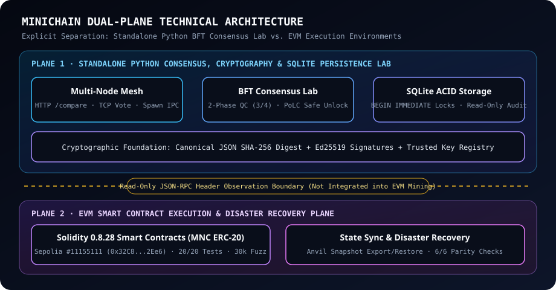

# Technical Architecture

## 1. Architectural Overview

MiniChain is organized into **two decoupled engineering planes** plus a **read-only web explorer**:

1. **Standalone Python Consensus & Cryptography Lab (`core-pow/` & `consensus-lab/`)**
2. **EVM Smart Contract & State Recovery Plane (`contracts/` & Sepolia Testnet)**
3. **MiniScan Static Web Explorer (`website/`)**

> **Important Integration Boundary:** Python consensus processes read block headers (`number`, `hash`, `parentHash`, `stateRoot`) from local Anvil EVM instances via JSON-RPC (`8545–8548`). They are **not** wired into Anvil's internal transaction ordering or block-mining engine.

---

## 2. Subsystem Breakdown

### 2.1 Nodes & P2P Observation (`p2p.py`, `validators.py`, `network_consensus_v4.py`, `monitor.py`)
- **HTTP Peer Comparison (`p2p.py`)**: Runs `ThreadingHTTPServer` peers on `127.0.0.1:9101` and `127.0.0.1:9102`, exposing `/head` and `/compare` to detect height, hash, parent, and `stateRoot` divergence.
- **Process-Isolated Validators (`validators.py`, `network_consensus_v4.py`)**: Spawns independent OS processes (`mp.get_context("spawn")`) communicating over unidirectional pipes and TCP sockets with an 8,192-byte frame ceiling and strict per-round challenge verification.

### 2.2 Consensus State Machine (`bft_test.py`, `two_phase.py`, `cross_round_test.py`, `leader_test.py`, `unlock_test.py`)
- **Quorum Safety (`bft_test.py`)**: Validates safety boundaries for `(3,2,f)`, `(4,3,f)`, and `(7,5,f)` validator sets.
- **Two-Phase Voting (`two_phase.py`)**: Implements Phase 1 `PREVOTE` certificate aggregation (`>= 3/4` signatures), computes a deterministic SHA-256 certificate digest, and requires that digest inside Phase 2 `PRECOMMIT` votes.
- **Leader Rotation (`leader_test.py`)**: Deterministic round-robin proposer `(round_id - 1) % 4` handling offline timeouts and invalid proposal view changes.
- **PoLC Safe Unlock (`unlock_test.py`)**: Prevents split-lock deadlocks while preserving safety across rounds.

### 2.3 Cryptography (`core-pow/blockchain.py`, `identity_v4.py`, `signed_consensus.py`)
- **Hashing**: `SHA-256` over canonical UTF-8 JSON (`sort_keys=True`) in Python labs; `keccak256` in EVM contracts.
- **Signatures**: `Ed25519` (`cryptography.hazmat.primitives.asymmetric.ed25519`) in Python labs; `secp256k1` in EVM transactions.
- **Key Hygiene**: Runtime validator keys are generated locally with `0600` file permissions inside `.gitignore`-protected directories and are never committed to version control.

### 2.4 EVM Smart Contracts (`contracts/src/`)
- `MiniChain.sol`: Baseline counter + string storage contract emitting `Updated(uint256)`.
- `MiniChainV2.sol`: Immutable `owner` access control with custom error `Unauthorized()` and `MessageUpdated(string)` event.
- `MNC.sol`: Zero-dependency `Solidity ^0.8.28` ERC-20 token (`1,000,000 MNC`, `18` decimals) deployed on Ethereum Sepolia at `0x32C80Bb0fd51D32c31b52795a181042BF90E2Ee6`.

### 2.5 Storage & Read-Only History Audit (`ledger_v4.py`, `locking_test.py`, `finality_test.py`, `audit_v4.py`)
- Uses `SQLite` with `BEGIN IMMEDIATE` transactions for lock persistence (`locks` table) and single-winner height finality (`finalized` table).
- `audit_v4.py` opens historical round databases using SQLite read-only URI mode (`?mode=ro`) and re-verifies every stored Ed25519 signature and vote tally.

### 2.6 State Synchronization & Disaster Recovery (`sync.py`, `recovery_check.py`)
- Exports full EVM account, bytecode, and storage tries via `anvil_dumpState` and restores onto clean recovery nodes via `anvil_loadState`, verifying 6 post-recovery invariants.
